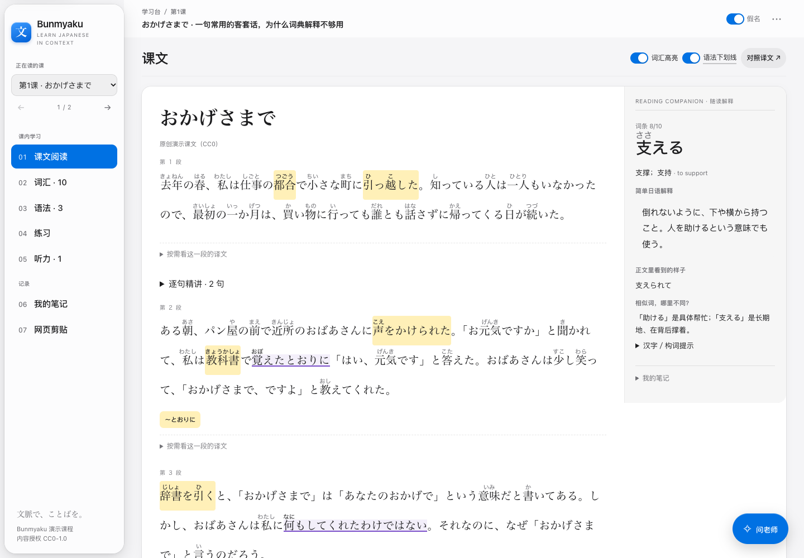
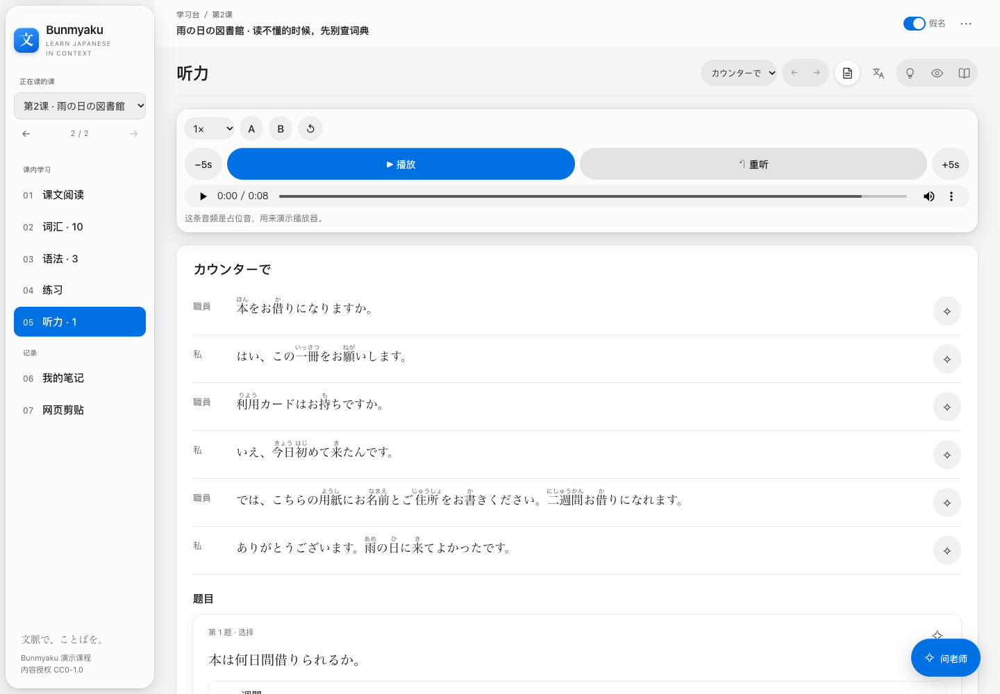
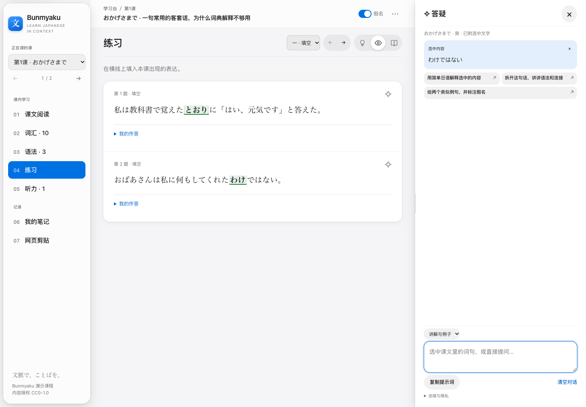
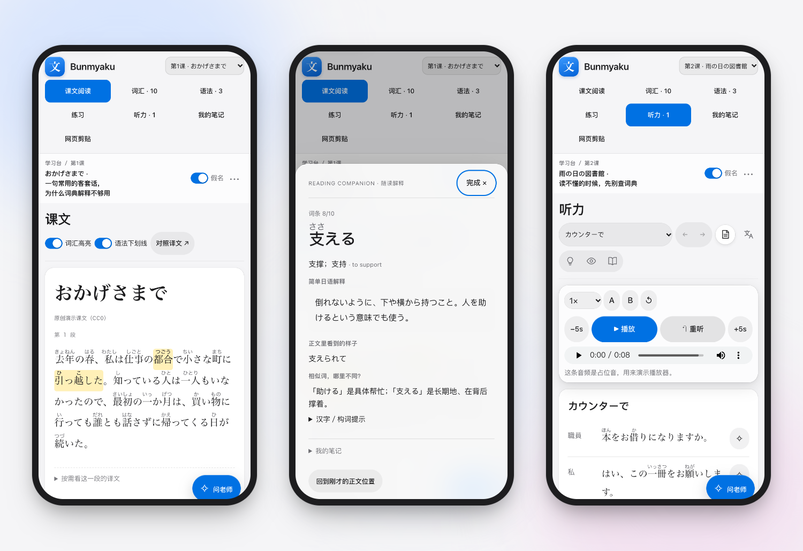

<div align="center">

# Bunmyaku · 文脈

**把你手里的任何日语材料，变成一个能读、能查、能练、能问的本地学习台。**

Learn Japanese in context · 课文阅读 · 词汇辨析 · 听力精听 · 带上下文的答疑

中文 · [日本語](README.ja.md) · [English](README.en.md)

[在线试用](https://rexxall.github.io/bunmyaku-nihongo/) · [三分钟跑起来](#三分钟跑起来) · [课程包格式](docs/pack-format.md) · [让 agent 帮你做课程包](#让-agent-帮你做课程包) · [部署与开发](docs/development.md)

</div>



## 它是什么

Bunmyaku 是一个本地网页工具。它不内置教材；你（或你的 AI agent）把课文、词表、对话稿和录音整理成一个**课程包**文件夹，它就把这些内容变成一个学习台：

| 学习场景 | 你能做什么 |
| --- | --- |
| 课文阅读 | 原文带假名，词条高亮、语法下划线，点词即看释义；译文按需展开，逐句精讲 |
| 词汇 | 词条卡：整词读音、简单日语释义、近义辨析、构词提示；用自己的话写解释，课文定位 |
| 练习 | 填空原位显示答案、选择题标出正确项、改写与开放题；提示／答案／讲解分别开关 |
| 听力 | 播放、变速、±5 秒、重听、A/B 循环与片段保存；逐行文稿与译文可分别隐藏 |
| 答疑 | 选中任何词句提问，服务端只把本课已校对文字送给模型；没有密钥也能复制提示词 |
| 网页剪贴 | 在任何网页选中日文，用书签小工具或浏览器扩展（Chrome／Edge）送进学习台；确认后存进当前学习档案，可以就这段问老师，也可以导出成纯文本再用导入器做成一课 |
| 记录 | 笔记、作答、听力进度按学习档案保存在浏览器；一人学默认一个档案，结伴学可加人；导出 Markdown，生词连同原文例句和自己的解释可导出给 Anki |
| 界面 | 中文、日本語、English，跟随浏览器语言，右上角菜单可切换；课程内容本身不翻译。浅色、深色跟随系统设置；系统要求降低透明度或减少动态效果时，浮层改成实底、不播放动画 |

服务端是一个 Python 标准库脚本，没有数据库、账号或云端。内容来自本机文件夹，密钥留在本机，答疑按你自己的 API 账户计费。







## 三分钟跑起来

不想安装，先点 [在线试用](https://rexxall.github.io/bunmyaku-nihongo/) 看演示课程：阅读、词汇、练习、听力和笔记都能用，答疑需要在本机运行。

需要 Python 3.9 或更新版本，不需要安装任何依赖。

```sh
git clone https://github.com/Rexxall/bunmyaku-nihongo.git
cd bunmyaku-nihongo
python3 -m bunmyaku --open
```

浏览器会打开 <http://127.0.0.1:8765/>，里面是两课原创演示课程（CC0）。不想敲命令的话，双击仓库里的 `bunmyaku.command`（macOS／Linux）或 `bunmyaku.bat`（Windows）效果相同。想在手机上用，加 `--bind` 指定电脑的局域网 IP。

**接上答疑**（可选）：

```sh
python3 configure_ai.py
```

选一个预设：任意 OpenAI 兼容端点、DeepSeek、OpenAI，或本机 Ollama（不需要密钥）。不配置也能用：答疑栏会把问题和本课资料拼成一段提示词，复制到任何聊天工具里即可。服务端发给模型的内容见 [答疑上下文协议](docs/tutor-protocol.md)。

**换成自己的材料**：

```sh
python3 -m bunmyaku --content ~/my-pack
```

课程包就是一个文件夹：`pack.json` ＋ `lessons/*.json` ＋ 可选 `media/`。字段说明见 [课程包格式](docs/pack-format.md)，`examples/demo-pack/` 是完整样例。

## 让 agent 帮你做课程包

课程包是给人读也给 agent 写的格式。仓库自带 `.claude/skills/make-course-pack/` 技能与 `AGENTS.md` 说明，对 Claude Code、Codex 等说一句“把这课做成课程包”，agent 会按固定步骤工作：先读完材料全文、按段分句、词条只取自原文、译文标明机器译还是人校、注音逐词核对、跑校验器，最后列出“需要人核对”的清单。它不允许编造例句出处，也不允许把没核过的注音标成已核。

两个纯本地工具配合这件事：

```sh
python3 tools/validate_pack.py my-pack          # 结构、引用、注音覆盖率、练习答案
python3 tools/import_text.py --text 课文.txt --vocab 词表.csv --out my-pack --id my-pack   # 纯文本 → 最小课程包
```

词表也可以直接用 Anki 的牌组：导出“Notes in Plain Text”（.txt），或勾选“Support older Anki versions”导出 .apkg，再用 `--map word=1,reading=2,meaning=3` 指明哪一列是什么。Anki 式注音 `日本[にほん]語[ご]` 会拆成词和读音。

## 数据与隐私

- 学习记录保存在当前浏览器，按课程包、课、学习档案分开；不自动跨设备同步，需要时导出。
- 网页剪贴只存在当前浏览器的当前学习档案下，服务端没有写入接口；书签小工具只把选中文字、网页标题和网址交给学习台页面。
- 服务只提供页面、接口和课程包里引用到的音频；课程包文件本身和仓库文件不会被暴露。
- 答疑只在发送时提交问题、选中文字、本课已校对文字和最近对话；就某段剪贴提问时，用这段剪贴代替本课文字。音频、笔记、密钥不发送。
- 版权教材与私人课程包放在仓库外的目录，用 `--content` 指向即可，永远不要提交进 Git。

## 项目结构

```text
bunmyaku/           python3 -m bunmyaku 启动入口与版本号
serve.py            本地 HTTP 服务与答疑转发
packlib.py          课程包加载
manage.py           版本快照、校验、发布与回退
configure_ai.py     答疑接口配置
src/                页面骨架、交互逻辑与样式
tools/              课程包校验器、导入器与静态导出
examples/demo-pack  原创演示课程包（CC0）
docs/               格式说明、答疑协议、部署与开发、难点与踩坑
test_*              服务端、发布流程、工具与浏览器测试
```

## 参与贡献

报错、建议和代码都欢迎，先看 [CONTRIBUTING.md](CONTRIBUTING.md)。版权教材内容不要贴进 issue 或 PR。

## 许可证

代码采用 [MIT](LICENSE)。演示课程内容采用 CC0。打包的 [Marked](https://github.com/markedjs/marked) 保留其 MIT 许可。你自己的课程包按其内容的授权处理。
